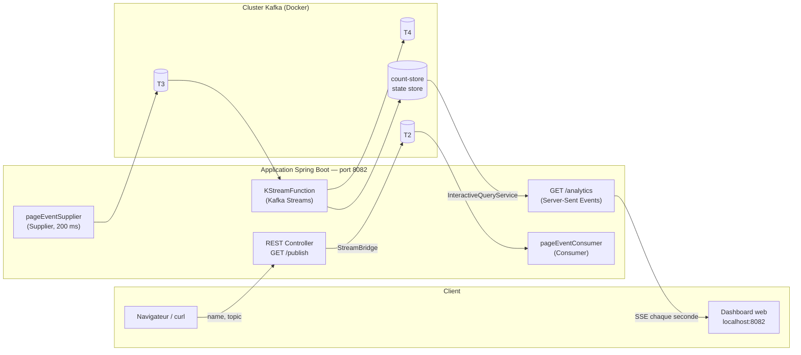
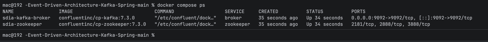
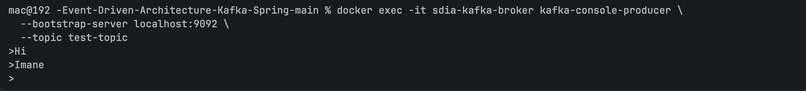
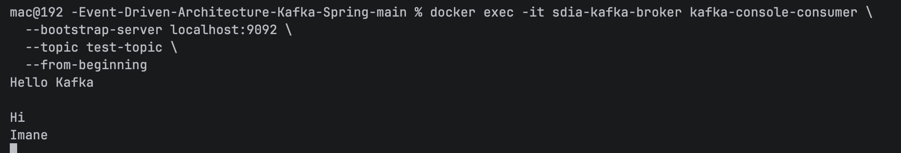
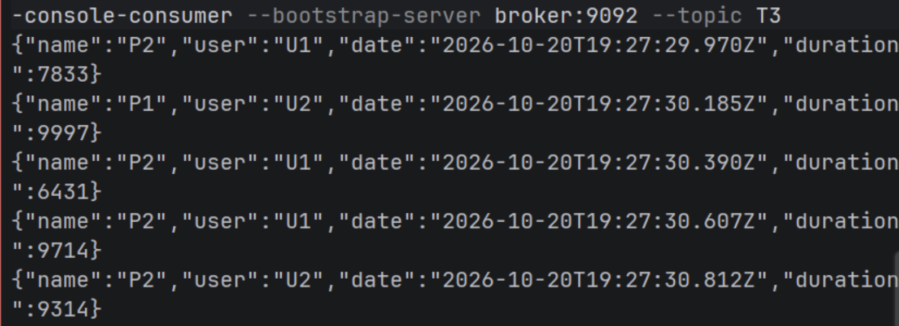
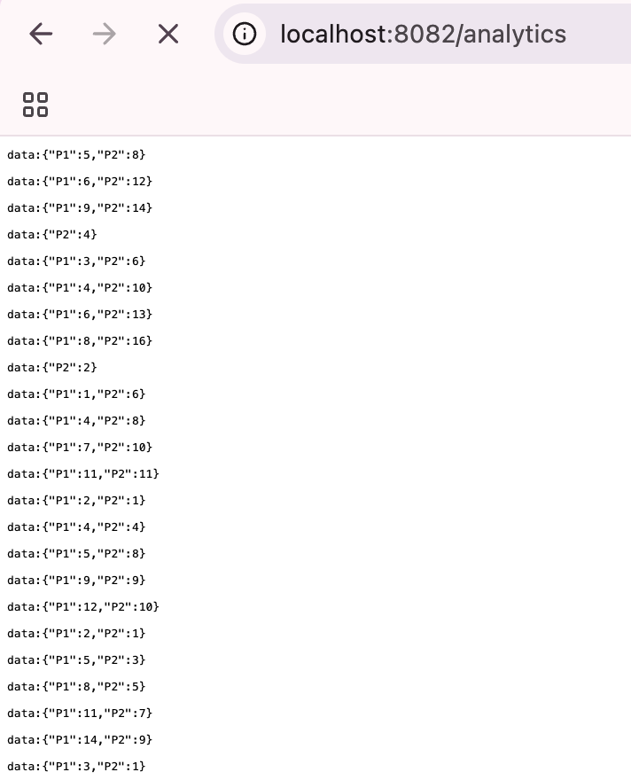
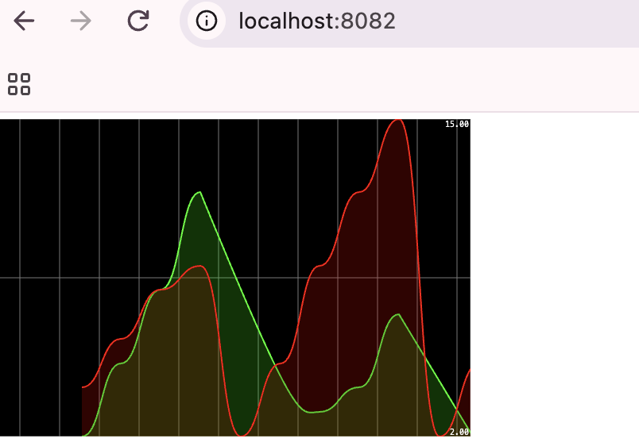

 <div align="center">

# Event-Driven Architecture : Kafka & Spring Cloud Stream

**Activité Pratique N°3 — Architectures pilotées par les événements**


</div>

| | |
|---|---|
| **Auteure** | Imane Mekkaoui |
| **Formation** | Master SDIA — Systèmes Distribués et Intelligence Artificielle (ENSET Mohammedia, Université Hassan II de Casablanca) |
| **Module** | Systèmes distribués |
| **Année universitaire** | 2026/2027 |
| **Enseignant** | Mohamed YOUSSFI |

---

## Table des matières

1. [Objectifs](#1-objectifs)
2. [Architecture](#2-architecture)
3. [Stack technique](#3-stack-technique)
4. [Structure du projet](#4-structure-du-projet)
5. [Partie 1 — Kafka avec Docker](#5-partie-1--kafka-avec-docker)
6. [Partie 2 — Spring Cloud Stream](#6-partie-2--spring-cloud-stream)
7. [Partie 3 — Analytics temps réel (Kafka Streams)](#7-partie-3--analytics-temps-réel-kafka-streams)
8. [Interface web temps réel](#8-interface-web-temps-réel)
9. [Installation et exécution](#9-installation-et-exécution)
10. [Tests](#10-tests)
11. [Conclusion](#11-conclusion)

---

## 1. Objectifs

Ce projet met en pratique les concepts d'une **architecture orientée événements (EDA)** avec **Apache Kafka** :

- Déployer **Zookeeper** et un **broker Kafka** avec **Docker Compose**.
- Valider l'infrastructure avec `kafka-console-producer` et `kafka-console-consumer`.
- Développer avec **Spring Cloud Stream** (modèle fonctionnel) :
  - un **Producer** exposé via un **REST Controller** ;
  - un **Consumer** Kafka ;
  - un **Supplier** Kafka (génération automatique d'événements) ;
  - un service d'**analytics temps réel** avec **Kafka Streams**.
- Fournir une **application web** qui affiche en temps réel les résultats de l'analyse du flux.

---

## 2. Architecture



### Flux de données

| Étape | Composant | Topic | Rôle |
|:-:|---|:-:|---|
| 1 | `PageEventController` (`/publish`) | **T2** (au choix via `?topic=`) | Publie un événement à la demande |
| 2 | `pageEventConsumer` | **T2** | Consomme et affiche chaque événement |
| 3 | `pageEventSupplier` | **T3** | Génère un événement toutes les 200 ms |
| 4 | `KStreamFunction` | **T3 → T4** | Filtre, agrège et compte par fenêtre de 5 s |
| 5 | `/analytics` | state store `count-store` | Diffuse les compteurs en SSE |
| 6 | Page web | — | Trace les courbes en temps réel |

---

## 3. Stack technique

| Domaine | Technologie |
|---|---|
| Langage / Framework | Java, Spring Boot |
| Messagerie | Apache Kafka (`confluentinc/cp-kafka:7.3.0`) |
| Coordination | Zookeeper (`confluentinc/cp-zookeeper:7.3.0`) |
| Abstraction | Spring Cloud Stream (functional programming model) |
| Stream processing | Kafka Streams (fenêtrage, state store, Interactive Queries) |
| Temps réel | Server-Sent Events (Spring WebFlux / Reactor) |
| Conteneurisation | Docker & Docker Compose |
| Build | Maven (Maven Wrapper inclus) |

---

## 4. Structure du projet

```text
Event-Driven-Architecture-Kafka/
├── compose.yml                          # Zookeeper + Kafka broker
├── pom.xml
├── mvnw / mvnw.cmd                      # Maven Wrapper
├── readme-kafka/
│   └── docs/
│       └── images/                      # Captures de tests
└── src/
    ├── main/
    │   ├── java/net/mekkaouiimane/kafkaspringcloudstream/
    │   │   ├── KafkaSpringCloudStreamApplication.java
    │   │   ├── events/PageEvent.java            # Modèle de domaine
    │   │   ├── controllers/PageEventController.java
    │   │   └── handlers/PageEventHandler.java   # Consumer, Supplier, KStream
    │   └── resources/
    │       ├── application.properties           # Bindings & topics
    │       └── static/                          # Interface web temps réel
    └── test/                                    # Tests Spring Boot
```

### Modèle de domaine

```java
public record PageEvent(String name, String user, Date date, long duration) {}
```

Exemple d'événement sérialisé en JSON :

```json
{"name":"P2","user":"U1","date":"2026-10-20T19:27:29.970Z","duration":7833}
```

---

## 5. Partie 1 — Kafka avec Docker

### 5.1 Démarrage de l'infrastructure

Le fichier `compose.yml` déploie deux conteneurs : **Zookeeper** et le **broker Kafka** (port `9092`).

```bash
docker compose up -d
docker compose ps
```

<p align="center">
  
  <br>
  <em>Figure 1 — Conteneurs <code>sdia-zookeeper</code> et <code>sdia-kafka-broker</code> démarrés</em>
</p>

### 5.2 Test avec `kafka-console-producer`

```bash
docker exec -it sdia-kafka-broker kafka-console-producer \
  --bootstrap-server localhost:9092 \
  --topic test-topic
```

<p align="center">
  
  <br>
  <em>Figure 2 — Envoi de messages dans le topic <code>test-topic</code></em>
</p>

### 5.3 Test avec `kafka-console-consumer`

```bash
docker exec -it sdia-kafka-broker kafka-console-consumer \
  --bootstrap-server localhost:9092 \
  --topic test-topic \
  --from-beginning
```

<p align="center">
  
  <br>
  <em>Figure 3 — Réception des messages (<code>Hello Kafka</code>, <code>Hi</code>, <code>Imane</code>)</em>
</p>

> Les messages produits à la Figure 2 sont bien relus par le consommateur : le broker fonctionne correctement.

---

## 6. Partie 2 — Spring Cloud Stream

L'application `kafka-spring-cloud-stream` s'exécute sur le port **8082** et déclare ses fonctions dans `application.properties` :

```properties
spring.application.name=kafka-spring-cloud-stream
server.port=8082

spring.cloud.function.definition=pageEventConsumer;pageEventSupplier;KStreamFunction

# Consumer : lit T2
spring.cloud.stream.bindings.pageEventConsumer-in-0.destination=T2

# Supplier : écrit dans T3 toutes les 200 ms
spring.cloud.stream.bindings.pageEventSupplier-out-0.destination=T3
spring.cloud.stream.bindings.pageEventSupplier-out-0.producer.poller.fixed-delay=200

# Kafka Streams : lit T3, écrit dans T4
spring.cloud.stream.bindings.KStreamFunction-in-0.destination=T3
spring.cloud.stream.bindings.KStreamFunction-out-0.destination=T4
spring.cloud.stream.kafka.streams.binder.configuration.commit.interval.ms=1000
```

### 6.1 Producer — REST Controller

`GET /publish?name=<page>&topic=<topic>` construit un `PageEvent` (utilisateur aléatoire `U1`/`U2`, date courante, durée aléatoire) et l'envoie via `StreamBridge`.

```bash
curl "http://localhost:8082/publish?name=P1&topic=T2"
```

### 6.2 Consumer

Le bean `pageEventConsumer` (`Consumer<PageEvent>`) consomme le topic **T2** et journalise chaque événement dans la console de l'application.

### 6.3 Supplier

Le bean `pageEventSupplier` (`Supplier<PageEvent>`) génère automatiquement un événement toutes les **200 ms** : page `P1`/`P2`, utilisateur `U1`/`U2`, durée comprise entre 10 et 10 009.

Vérification directe des messages produits dans le topic **T3** :

```bash
docker exec -it sdia-kafka-broker kafka-console-consumer \
  --bootstrap-server broker:9092 \
  --topic T3
```

<p align="center">
  
  <br>
  <em>Figure 4 — Événements <code>PageEvent</code> générés par le Supplier dans le topic <code>T3</code></em>
</p>

---

## 7. Partie 3 — Analytics temps réel (Kafka Streams)

La fonction `KStreamFunction` traite le flux de **T3** :

```java
@Bean
public Function<KStream<String, PageEvent>, KStream<String, Long>> KStreamFunction() {
    return input -> input
        .filter((k, v) -> v.duration() > 100)                        // 1. filtrage
        .map((k, v) -> new KeyValue<>(v.name(), v.duration()))       // 2. clé = nom de la page
        .groupByKey(Grouped.with(Serdes.String(), Serdes.Long()))    // 3. regroupement
        .windowedBy(TimeWindows.ofSizeWithNoGrace(Duration.ofSeconds(5))) // 4. fenêtre de 5 s
        .count(Materialized.as("count-store"))                       // 5. comptage + state store
        .toStream()
        .map((k, v) -> new KeyValue<>(k.key(), v));                  // 6. sortie vers T4
}
```

| Opération | Description |
|---|---|
| **Filtrage** | Ignore les visites de durée ≤ 100 |
| **Regroupement** | Par nom de page (`P1`, `P2`) |
| **Fenêtrage** | Fenêtres *tumbling* de 5 secondes, sans période de grâce |
| **Agrégation** | Nombre de visites par page, matérialisé dans `count-store` |

### Endpoint `/analytics` (Server-Sent Events)

`GET /analytics` (`text/event-stream`) interroge le state store `count-store` via `InteractiveQueryService` et émet **chaque seconde** le nombre de visites par page sur les 5 dernières secondes.

<p align="center">
  
  <br>
  <em>Figure 5 — Flux SSE sur <code>localhost:8082/analytics</code> : <code>{"P1":5,"P2":8}</code>, …</em>
</p>

---

## 8. Interface web temps réel

La page d'accueil `http://localhost:8082` se connecte à `/analytics` (EventSource) et trace, en temps réel, une courbe par page (`P1`, `P2`) représentant le nombre de visites sur la fenêtre glissante.

<p align="center">
  
  <br>
  <em>Figure 6 — Dashboard : évolution en direct des compteurs par page</em>
</p>

---

## 9. Installation et exécution

### Prérequis

- JDK (version définie dans le `pom.xml`)
- Docker & Docker Compose
- Maven (ou le wrapper `./mvnw` fourni)

### Étapes

```bash
# 1. Cloner le dépôt
git clone https://github.com/ImaneMekkaoui1/Event-Driven-Architecture-Kafka.git
cd Event-Driven-Architecture-Kafka

# 2. Démarrer Zookeeper et Kafka
docker compose up -d

# 3. Lancer l'application
./mvnw spring-boot:run
```

### Points d'accès

| URL | Description |
|---|---|
| `http://localhost:8082/` | Dashboard temps réel |
| `http://localhost:8082/analytics` | Flux SSE des compteurs |
| `http://localhost:8082/publish?name=P1&topic=T2` | Publication d'un événement |

### Arrêt

```bash
docker compose down
```

---

## 10. Tests

Des tests Spring Boot vérifient le chargement du contexte applicatif.

```bash
./mvnw test
```

Les tests de l'infrastructure Kafka (producer / consumer en ligne de commande) sont documentés en [partie 5](#5-partie-1--kafka-avec-docker).

---


## 11. Conclusion

Ce projet illustre une chaîne événementielle complète : **production** (REST + Supplier), **transport** (Kafka), **consommation** (Consumer), **traitement en flux** (Kafka Streams avec fenêtrage et state store) et **restitution temps réel** (SSE + interface web).

Spring Cloud Stream, via son modèle fonctionnel, découple la logique métier du broker et réduit fortement le code d'infrastructure.

---

<div align="center">

Réalisé par **Imane Mekkaoui** — Master SDIA, ENSET Mohammedia · 2026/2027

</div>